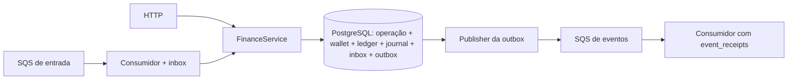
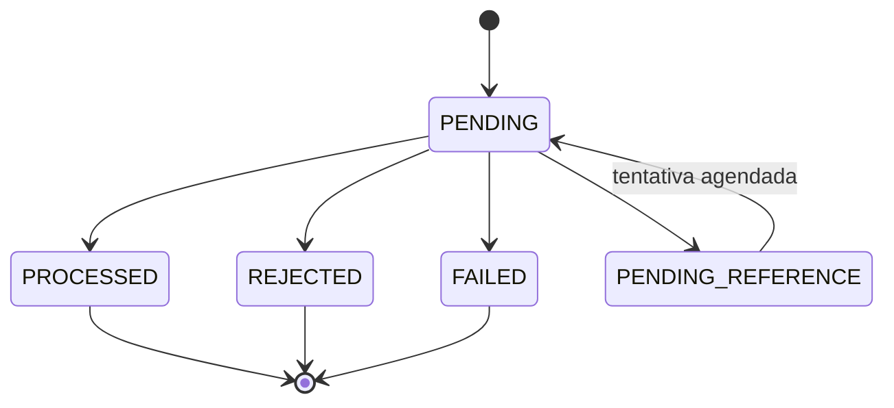

# Arquitetura e decisões

## Estrutura

Um executável NestJS atende HTTP e inicia trabalhadores de SQS, referências e
outbox. Cada instância usa o mesmo PostgreSQL e as mesmas filas. Os testes iniciam
três processos independentes; nenhum estado em memória decide se dinheiro pode
ser movimentado novamente.

- `domain`: Money, Wallet, WagerTransaction, ledger, inbox/outbox e eventos. Não
  importa NestJS, PostgreSQL nem tipos de persistência.
- `application`: valida contratos, coordena regras e consultas.
- `infra/database`: MikroORM, mapeamento da wallet e sessão SQL transacional.
- `infra/http`: controllers, respostas e ponto de extensão de identidade.
- `infra/messaging`: transporte, confirmação, retry e publicação.
- `infra/observability`: logs e rastreamento manual com OpenTelemetry.

A aplicação usa uma classe concreta pequena para o banco. Não há uma interface
por tabela ou camadas genéricas de repositories. O domínio permanece independente;
a coordenação transacional usa SQL explícito onde locks e constraints importam.

## Representação de dinheiro

Entradas/saídas: `{ amount: "25.00", currency: "BRL" }`. Money só aceita string
decimal não negativa com duas casas, sem coerção ou arredondamento. Um clone
privado do Decimal com precisão 40 evita influência de configuração global.
O limite é `99999999999999.99`, alinhado ao NUMERIC(16,2). Resultados internos
podem ser negativos, por exemplo a diferença de reconciliação; carteiras não.
As moedas são validadas pelo catálogo ISO-4217 do runtime Intl. BRL e USD são
exercitadas nos testes; não há conversão cambial.

O MikroORM mapeia o saldo decimal para **string** e a moeda para coluna separada.
A reidratação constrói Money sem passar por number. A factory de reidratação
reconstrói o estado persistido, sem executar novamente uma movimentação.

## Uma operação financeira

1. Validar os campos de negócio e calcular SHA-256 do JSON canônico.
2. Abrir `em.fork().transactional()`: cada chamada tem seu próprio Unit of Work.
3. Obter locks transacionais por chave de idempotência, ID externo e mensagem,
   em ordem estável. Eles cobrem também chaves ainda não inseridas.
4. Consultar a operação já registrada: retornar seu resultado histórico ou conflito.
5. Bloquear **a linha da wallet** com `FOR UPDATE` pelo MikroORM.
6. Reidratar as classes, validar referência e aplicar o efeito no domínio.
7. Persistir operação, ledger, duas partidas, inbox e eventos da outbox na mesma
   conexão/transação. O MikroORM grava o saldo e a versão antes do commit.
8. Confirmar no banco. Só então responder HTTP ou permitir o ack na fila.

O lock por chave não substitui o lock por wallet: operações diferentes da mesma
carteira disputam o saldo. Carteiras distintas têm linhas distintas e avançam em
paralelo. O hash de 64 bits usado pelo advisory lock pode ter colisão: isso pode
serializar duas chaves diferentes, mas não permite duplicação nem mistura recibos.
Os valores reais continuam comparados e protegidos por índices únicos.

Não existe lock global no processamento financeiro. O lock global de **migrations**
só protege mudanças de schema na inicialização. Lock timeout: 5 s; statement timeout:
15 s; transação ociosa: 30 s. Conflitos transitórios voltam ao chamador/à fila para
retry limitado, sempre com a identidade original.

## Idempotência

A fonte de identidade HTTP é o header obrigatório; SQS usa `data.idempotencyKey`.
Chaves são globais. `(providerId, externalTransactionId)` também é único.
Trocar a chave para reutilizar um ID externo resulta em conflito, mesmo com mesmo
corpo. Compartilhar a chave com outro provedor também é conflito.

O hash usa somente o pedido validado e normalizado: provider, external ID, player,
wallet, round, game, kind, amount/currency e referência opcional. Chaves de objetos
são ordenadas recursivamente; arrays preservam ordem. Campos desconhecidos são
recusados. Header, messageId, horário de transporte e correlationId não entram.
Undefined, ciclos, BigInt e valores não JSON são recusados pelo canonicalizador.

`wager_transactions.response` conserva saldo e estado observados na aplicação.
Replays terminais retornam esse recibo, mesmo que outras apostas tenham ocorrido.
Uma operação pendente pode avançar para um recibo terminal; replays passam a
retornar o resultado terminal, que então fica imutável.

A inbox usa `(consumer_name, message_id)` e verifica o hash. O consumidor de
eventos usa `(consumer_name, event_id)` com hash persistente, independentemente
da deduplicação temporária do broker.

## Estados e referências

PROCESSED, REJECTED e FAILED são terminais na classe e no schema. Dados de negócio
de uma operação persistida também não podem ser alterados no banco. OPENING é
criado internamente, com provedor reservado, e nunca é aceito pelos contratos externos.

- BET exige valor positivo e saldo suficiente. WIN pode ser zero e ter referência
  opcional a BET. LOSS registra resultado sem ledger nem mudança de versão.
- REFUND exige BET processada. ROLLBACK admite BET, WIN ou REFUND processadas e
  inverte o sentido. Valores de reversão precisam ser iguais à referência.
- Provider, player, wallet, moeda e rodada precisam coincidir. O gameId é guardado,
  mas não amplia o conjunto de igualdade exigido pelo enunciado.
- Há uma reversão processada por `(referência, tipo)`, garantida por índice parcial.
  A restrição é por **tipo**, como no enunciado: REFUND e ROLLBACK distintos podem
  referenciar a mesma BET. Isso não é tratado como uma reversão duplicada do mesmo tipo.
- Referência ainda não encontrada ou ainda pendente mantém PENDING_REFERENCE.
  Referência terminal rejeitada ou de tipo incompatível causa rejeição auditável.
- Trabalhadores reavaliam pendências com delays de 1, 2, 4... segundos, teto de
  cinco minutos, até oito tentativas ou TTL de uma hora. O primeiro limite atingido
  resulta em REJECTED/REFERENCE_EXPIRED e evento. O TTL também cobre indisponibilidade
  prolongada ou ausência de workers; sua aplicação acontece quando o worker retoma.

## Ledger e partidas dobradas

Uma carteira positiva nasce com OPENING/CREDIT e versão 1. Carteira zero não gera
movimentação fictícia. Toda movimentação positiva posterior incrementa versão uma vez.
WIN de zero, LOSS e rejeições não geram ledger nem WalletBalanceChanged.

O ledger da wallet continua tendo uma entrada por transação. O bônus usa duas
partidas em `journal_postings`: `wallet:<id>` e `clearing:<currency>`, com valores
iguais e sentidos contrários. Clearing é uma conta técnica de compensação, sem
saldo de jogador. Este é um diário balanceado de escopo limitado, não um plano
contábil completo de uma instituição financeira.

Constraints verificam não negatividade, aritmética, unicidade, vínculo entre
operação/wallet/moeda, cadeia de saldos, soma final e balanceamento das partidas.
As verificações que dependem de várias tabelas são diferidas até o commit.
Triggers recusam UPDATE, DELETE e TRUNCATE do ledger e das partidas.
Como em qualquer PostgreSQL, um administrador pode remover constraints ou tabelas;
as garantias pressupõem o schema aplicado e operações normais da aplicação.

Reconciliação bloqueia a mesma wallet antes de ler a soma, evitando um retrato
misturado de antes/depois de uma aposta. Divergências são retornadas, logadas e
contadas; não há reparo automático ou exclusão de histórico.

## Mensagens e recuperação

Há quatro consumidores de entrada e dois publishers por processo. O publisher
seleciona até dez linhas da outbox com `FOR UPDATE SKIP LOCKED`, mantém os locks durante
o envio em lote e grava `published_at` somente nas entradas confirmadas pelo SQS.
Entradas sem confirmação recebem backoff individual. O estado persistido na outbox
permite retomar o envio após uma falha, sem leases adicionais.

| Ponto da falha                                  | Resultado                                                    |
| ----------------------------------------------- | ------------------------------------------------------------ |
| Antes do commit financeiro                      | PostgreSQL desfaz tudo; a mensagem pode voltar               |
| Após commit, antes de responder/ack             | Replay recupera o recibo e não movimenta dinheiro            |
| Após commit, antes de publicar evento           | Outra instância encontra a outbox pendente                   |
| Após envio do evento, antes de marcar publicado | Pode reenviar o mesmo eventId; consumidor deduplica no banco |
| SQS indisponível                                | Outbox fica pendente com attempts/nextAttemptAt e backoff    |
| Referência ausente                              | Operação fica pendente, sem movimentação antecipada          |

Não existe promessa de entrega exatamente uma vez entre PostgreSQL e SQS.
O desenho aceita publicação repetida e garante efeito financeiro único.
O banco pode confirmar e a conexão cair antes de o cliente saber o resultado;
nesse caso o cliente repete a identidade original.

O consumidor confirma resultados de negócio após commit. Payload malformado e
conflito são permanentes e seguem para DLQ; carteira inexistente é terminal de
validação e recebe ack. Falhas transitórias voltam com delays de 2/4 segundos,
com limite de três recebimentos. Há redrive no broker como proteção adicional.
Se o banco estiver indisponível, nenhuma marca de FAILED é inventada: a mensagem
na fila/DLQ conserva o pedido para diagnóstico. FAILED existe no domínio/schema
para falha permanente de uma operação aceita, mas o fluxo atual não classifica
automaticamente um erro desconhecido de programação como falha financeira terminal.

Mensagens em andamento renovam visibilidade. SIGTERM interrompe novas requisições,
drena o trabalho atual e fecha conexões; Compose permite 60 s. SIGKILL é coberto
por timeout da visibilidade e rollback/liberação de locks. Eventos podem chegar
fora de ordem entre publishers; consumidores de saldo devem observar walletVersion.

## Códigos e HTTP

| Código                                        | Significado / ação esperada                             |
| --------------------------------------------- | ------------------------------------------------------- |
| INSUFFICIENT_FUNDS                            | BET sem saldo; resultado terminal                       |
| REVERSAL_INSUFFICIENT_FUNDS                   | ROLLBACK debitaria acima do saldo; terminal e auditável |
| PLAYER_MISMATCH / CURRENCY_MISMATCH           | Operação incompatível com a carteira                    |
| REFERENCE_MISMATCH / REFERENCE_KIND_INVALID   | Corrigir vínculo da referência                          |
| REFERENCE_NOT_PROCESSED                       | Referência terminal sem efeito financeiro válido        |
| REVERSAL_AMOUNT_MISMATCH                      | Reversão parcial ou valor incorreto                     |
| ALREADY_REVERSED                              | Já existe reversão processada do mesmo tipo             |
| REFERENCE_EXPIRED                             | Referência não se tornou válida no prazo                |
| BALANCE_LIMIT_EXCEEDED                        | Resultado ultrapassaria NUMERIC(16,2)                   |
| IDEMPOTENCY_CONFLICT / INBOX_PAYLOAD_CONFLICT | Não repetir com conteúdo diferente                      |
| INFRASTRUCTURE_UNAVAILABLE                    | Repetir com a mesma identidade                          |

400 é entrada inválida, 409 conflito, 422 rejeição de regra, 202 pendente e 503
falha transitória reconhecida. 404 identifica recurso inexistente. Erros internos
inesperados retornam 500 sem expor SQL, payload ou stack na resposta.

## Autenticação e operação local

A opção adotada é não integrar um IdP neste timebox, conforme permitido pelo README.
`ProviderIdentityGuard` é a extensão explícita; hoje permite a chamada. Em uma
integração real, verificaria assinatura, issuer, audience e expiração de um token
OIDC de Keycloak/Zitadel e vincularia o claim do provedor ao providerId solicitado.
Health permanece aberto. A fila é um canal interno, com validação de domínio idêntica.

As credenciais, portas e painéis do Compose são de desenvolvimento. A configuração
é deliberadamente local; não é um modelo de publicação pública em produção.

## Observabilidade e limites

Logs JSON registram IDs de correlação, mensagem, operação, carteira e provedor,
estado e replay. Não registram valores, corpos financeiros nem jogador.
Prometheus cobre estados, duplicatas, tentativas, DLQ, conflitos, espera pelo lock,
latência e idade/quantidade da outbox. Counters são por processo; reinícios os zeram.
A outbox é medida pelo estado persistente e não se perde com o processo.
OpenTelemetry instrumenta manualmente abertura e processamento, propaga traceparent
no envelope e exporta por OTLP/HTTP. Não há instrumentação automática de cada SQL.

Os triggers de consistência recalculam o histórico da wallet no commit. Isso
privilegia verificabilidade neste desafio, mas o custo cresce com o histórico de
uma carteira muito movimentada. Antes de uma escala de produção, seriam necessários
experimentos mais longos, índices/planos e uma estratégia de auditoria incremental.
O teste de carga documenta esse limite, sem alegar capacidade além da medição.

Referências: [transações MikroORM](https://mikro-orm.io/docs/transactions),
[locks PostgreSQL](https://www.postgresql.org/docs/16/explicit-locking.html),
[visibilidade SQS](https://docs.aws.amazon.com/AWSSimpleQueueService/latest/SQSDeveloperGuide/sqs-visibility-timeout.html),
[OpenTelemetry](https://opentelemetry.io/docs/languages/js/exporters/).
